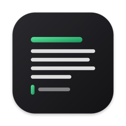

<p align="right"><b>Português</b> · <a href="README.en.md">English</a></p>

# GonService · Homebrew e downloads

Os aplicativos da [GonService](https://gonserviceit.com.br) para instalar pelo
[Homebrew](https://brew.sh) (macOS) ou baixar direto para Windows e Linux.

## Baixar o Reader



**Reader** — lê e edita markdown, texto e código; lê PDF e Word.
[Ver prints e como usar →](reader/)
<br clear="left">

<!-- downloads:reader -->
| Sistema | Baixar |
|---|---|
| macOS, pelo Homebrew | `brew install --cask gonservice/tap/reader-app` |
| macOS (Intel e Apple Silicon) | [Reader-1.0.4-macos.zip](https://github.com/GonService/homebrew-tap/releases/download/reader-v1.0.4/Reader-1.0.4-macos.zip) |
| Windows | [Instalador (.exe)](https://github.com/GonService/homebrew-tap/releases/download/reader-v1.0.4/Reader-1.0.4-windows-instalador.exe) · [.zip sem instalar](https://github.com/GonService/homebrew-tap/releases/download/reader-v1.0.4/Reader-1.0.4-windows.zip) |
| Linux | [Reader-1.0.4-linux-amd64.tar.gz](https://github.com/GonService/homebrew-tap/releases/download/reader-v1.0.4/Reader-1.0.4-linux-amd64.tar.gz) |

Versão atual: **1.0.4** · [todas as versões](https://github.com/GonService/homebrew-tap/releases)
<!-- /downloads:reader -->

## Baixar o Gantry


**Gantry** — containers, VMs e clusters Kubernetes desta máquina e dos servidores, numa janela só.
[Ver o que faz e como usar →](gantry/)
<br clear="left">

<!-- downloads:gantry -->
| Sistema | Baixar |
|---|---|
| macOS, pelo Homebrew | `brew install --cask gonservice/tap/gantry` |
| macOS (Intel e Apple Silicon) | [Gantry-0.42.0-macos.zip](https://github.com/GonService/homebrew-tap/releases/download/gantry-v0.42.0/Gantry-0.42.0-macos.zip) |
| Windows (experimental) | [Gantry-0.42.0-windows.zip](https://github.com/GonService/homebrew-tap/releases/download/gantry-v0.42.0/Gantry-0.42.0-windows.zip) |
| Servidor Linux, sem tela (abre no navegador) | [amd64](https://github.com/GonService/homebrew-tap/releases/download/gantry-v0.42.0/gantry-servidor-0.42.0-linux-amd64.tar.gz) · [arm64](https://github.com/GonService/homebrew-tap/releases/download/gantry-v0.42.0/gantry-servidor-0.42.0-linux-arm64.tar.gz) |

Versão atual: **0.42.0** · [todas as versões](https://github.com/GonService/homebrew-tap/releases)
<!-- /downloads:gantry -->

## Projetos

| | App | O que faz | Instalar no Mac |
|---|---|---|---|
|  | **[Reader](reader/)** | Lê e edita markdown, texto e código; abre PDF, Word e imagens. | `brew install --cask gonservice/tap/reader-app` |
|  | **[Gantry](gantry/)** | Gerencia containers (Docker, Podman, containerd), VMs e clusters Kubernetes, locais e por SSH. | `brew install --cask gonservice/tap/gantry` |

Cada app tem a sua pasta aqui, com prints e instruções de uso.

## Instalar no Mac (Homebrew)

Com o [Homebrew](https://brew.sh) instalado, cada app sai com um comando
(veja a tabela acima). Para atualizar tudo o que veio daqui:

```bash
brew upgrade --cask $(brew list --cask --full-name | grep '^gonservice/')
```

## Baixar para Windows e Linux

Os instaladores ficam em **[Releases](https://github.com/GonService/homebrew-tap/releases)**,
uma por versão de cada app (a tag começa com o nome do app, ex.: `reader-v1.0.0`).
Cada Release lista qual arquivo baixar para cada sistema.

## Sobre este repositório

- `Casks/` — as receitas do Homebrew. São atualizadas automaticamente a cada
  versão nova de um app; não edite à mão.
- Uma pasta por app (`reader/`, `gantry/`, …) — o que ele faz, prints e como usar.
- O código-fonte dos apps fica em repositórios privados da GonService; aqui
  ficam só os instaladores e a documentação.

Os apps são gratuitos e não têm a assinatura paga da Apple nem da Microsoft.
Pelo Homebrew isso não aparece; baixando direto, o sistema pede uma
confirmação na primeira abertura — a pasta de cada app explica como.
