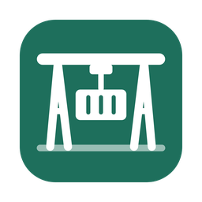

<p align="right"><b>Português</b> · <a href="README.en.md">English</a></p>

<p align="center">
  
</p>

<h1 align="center">Gantry</h1>

<p align="center">
  Containers, VMs e clusters Kubernetes desta máquina e dos seus servidores, numa janela só.<br>
  Feito pela <a href="https://gonserviceit.com.br">GonService</a>. Gratuito, para macOS, Windows (experimental) e servidores Linux.
</p>

## Por que existe

Quem cuida de infraestrutura costuma ter o Docker Desktop (ou o Portainer)
para os containers, o Lens para os clusters, um gerenciador de VMs e um
terminal com SSH aberto em cada servidor. O Gantry junta isso num app só,
sem nada instalado nos servidores: ele fala direto com o Docker, o Podman ou
o containerd de cada máquina (pelo SSH, nos servidores) e com a API do
Kubernetes. O que você cria pelo terminal aparece na hora na interface, e os
projetos são os seus próprios arquivos `compose.yaml`.

## Instalar

<!-- downloads:gantry -->
| Sistema | Baixar |
|---|---|
| macOS, pelo Homebrew | `brew install --cask gonservice/tap/gantry` |
| macOS (Intel e Apple Silicon) | [Gantry-0.39.2-macos.zip](https://github.com/GonService/homebrew-tap/releases/download/gantry-v0.39.2/Gantry-0.39.2-macos.zip) |
| Windows (experimental) | [Gantry-0.39.2-windows.zip](https://github.com/GonService/homebrew-tap/releases/download/gantry-v0.39.2/Gantry-0.39.2-windows.zip) |
| Servidor Linux, sem tela (abre no navegador) | [amd64](https://github.com/GonService/homebrew-tap/releases/download/gantry-v0.39.2/gantry-servidor-0.39.2-linux-amd64.tar.gz) · [arm64](https://github.com/GonService/homebrew-tap/releases/download/gantry-v0.39.2/gantry-servidor-0.39.2-linux-arm64.tar.gz) |

Versão atual: **0.39.2** · [todas as versões](https://github.com/GonService/homebrew-tap/releases)
<!-- /downloads:gantry -->

### macOS

Com o [Homebrew](https://brew.sh):

```bash
brew install --cask gonservice/tap/gantry
```

Para atualizar: `brew upgrade --cask gantry`. O app avisa no rodapé quando há
versão nova e mostra esse comando. Funciona em Mac Intel e Apple Silicon.

Prefere sem Homebrew? Baixe o `Gantry-X.Y.Z-macos.zip` na
[página de Releases](https://github.com/GonService/homebrew-tap/releases),
descompacte e arraste o **Gantry** para Aplicativos. Na primeira vez, clique
com o botão direito no app → **Abrir** (o app não tem a assinatura paga da
Apple).

Para os containers, o Gantry usa o Docker ou o Podman que já estiverem no Mac;
se não houver nenhum, ele ajuda a instalar.

### Windows (experimental)

Baixe o `Gantry-X.Y.Z-windows.zip`, descompacte e abra o `Gantry.exe`. Cada
distribuição do WSL2 aparece como uma máquina; instale o Docker ou o Podman
dentro dela. Se aparecer "O Windows protegeu o computador", clique em
**Mais informações → Executar assim mesmo**.

### Servidor Linux, sem tela

Para deixar o Gantry rodando num servidor e usar pelo navegador: baixe o
`gantry-servidor-X.Y.Z-linux-<amd64|arm64>.tar.gz`, descompacte e rode
`./gantry -no-browser`. Ele escuta só em `127.0.0.1:7777` e mostra no terminal
um link com a chave de acesso. Do seu computador, abra um túnel e use o link:

```bash
ssh -L 7777:127.0.0.1:7777 usuario@servidor
```

## O que ele faz

- **Máquinas:** este computador e servidores por SSH, organizados em pastas, com
  hardware, uso de CPU, memória e disco. Docker, Podman e containerd na mesma
  máquina aparecem juntos.
- **Projetos (compose):** subir, parar, atualizar imagens, **Reconstruir** (para
  quem tem `build:`), editar os arquivos na interface, aviso quando os arquivos
  mudam e o que muda em cada serviço, backup e restauração dos volumes e bancos,
  exportar e enviar para outra máquina.
- **Containers:** logs ao vivo com filtro, shell, arquivos (baixar e enviar),
  editar e recriar, recursos na hora, eventos, CPU e memória.
- **Modelos:** Postgres, Redis, RabbitMQ, Kafka, Prometheus + Grafana, Keycloak,
  n8n, Ollama e dezenas de outros, com portas livres escolhidas sozinhas. Os seus
  projetos também viram modelos.
- **VMs (QEMU):** VMs dentro do mesmo compose dos containers, com tela, console,
  SSH, snapshots, clones e importação de OVA/VMDK/VHD.
- **Clusters Kubernetes**, como no Lens: workloads, rede, configuração, nós,
  eventos, CRDs e Helm; detalhes de cada pod com containers, variáveis, volumes,
  logs (inclusive da execução anterior) e shell; encaminhar portas, escalar,
  reiniciar, voltar versão, esvaziar nós, aplicar YAML, gráficos de CPU e
  memória. As listas ordenam por qualquer coluna, e os botões seguem as
  permissões da sua conta.
- **Serviços compartilhados, segredos no Chaveiro do macOS, avisos de imagens
  mais novas, alertas do Prometheus** e um agente opcional para guardar
  métricas com o app fechado.

## Perguntas comuns

### Ele instala alguma coisa nos meus servidores?

Não. O Gantry usa o SSH que você já usa e conversa com o Docker, o Podman ou o
containerd de lá. Há um agente opcional, só se você quiser métricas guardadas
com o app fechado.

### Funciona com o meu `~/.kube/config`?

Sim: Configuração → Clusters lista os contextos dele, inclusive os que entram
por plugin (EKS, GKE, AKS) e por proxy.

### O Mac (ou o Windows) diz que o app não é verificado

O Gantry não tem a assinatura paga da Apple nem da Microsoft. Pelo Homebrew
isso não aparece. Baixando direto:

- **Mac:** botão direito no Gantry → **Abrir** → **Abrir**. Só na primeira vez.
  Se não aparecer a opção, vá em *Ajustes do Sistema → Privacidade e
  Segurança* e clique em **Abrir Mesmo Assim**.
- **Windows:** **Mais informações → Executar assim mesmo**.

### Meus dados vão para algum lugar?

Não. O Gantry roda no seu computador e só fala com as máquinas e clusters que
você cadastrou. A única consulta externa é a página de versões, para avisar
quando há uma nova.

---

<sub>© 2026 GonService. Construído com Go e Wails.</sub>
